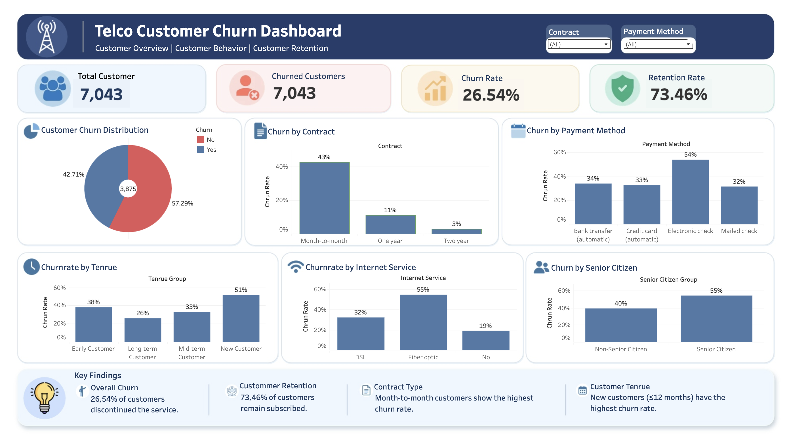

# Telco Customer Churn Analysis

## Project Overview
This project analyzes customer churn behavior in a telecommunications company using Tableau. The analysis aims to identify customer segments with higher churn rates and understand the factors associated with customer retention.

## Dashboard Preview

## Business Problem
Customer churn is a major challenge for telecommunications companies because losing customers can affect revenue and long-term business growth.

This project explores customer data to identify churn patterns and provide insights that can help the business improve customer retention.

## Project Objectives
- Analyze overall customer churn and retention rates.
- Identify customer segments with higher churn rates.
- Explore the relationship between customer characteristics and churn behavior.
- Present actionable insights through an interactive dashboard.

## Dataset
- **Source:** [Telco Customer Churn Dataset – Kaggle](https://www.kaggle.com/datasets/blastchar/telco-customer-churn)
- **Total Records:** 7,043 customers
- **Total Features:** 21 columns

## Tools Used
- Microsoft Excel – Data cleaning and preparation
- Tableau – Data visualization and dashboard development

## Data Cleaning & Preparation
The following steps were performed:
- Reviewed the dataset for missing and inconsistent values.
- Handled blank values in the `TotalCharges` column.
- Converted data fields into appropriate data types.
- Checked customer records and prepared the dataset for analysis.

## Key Findings
- **Overall Churn Rate:** 26.54% of customers discontinued the service.
- **Customer Retention:** 73.46% of customers remained subscribed.
- **Contract Type:** Month-to-month customers showed the highest churn rate.
- **Customer Tenure:** New customers (≤12 months) had the highest churn rate.

## Dashboard
Explore the interactive dashboard on Tableau Public:

[View Telco Customer Churn Dashboard]([https://public.tableau.com:9443/views/TelcoCustomerChurnDashboard_17953713607360/Dashboard2?:language=en-GB&publish=yes&:sid=&:redirect=auth&:display_count=n&:origin=viz_share_link](https://aabeey.github.io/telco-customer-churn-analysis/))

## Recommendations
- Develop targeted retention strategies for month-to-month customers.
- Improve onboarding experiences for new customers.
- Identify potential churn risks early and provide appropriate retention offers.

---

**Project Type:** Data Analytics Portfolio Project  
**Role:** Data Analyst (Personal Project)
